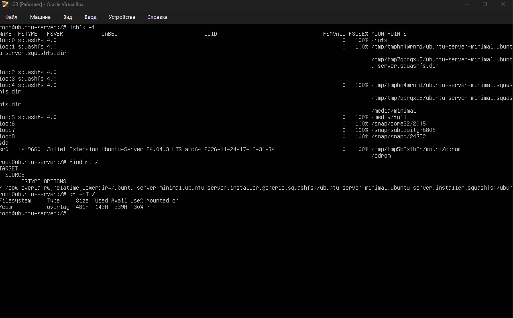
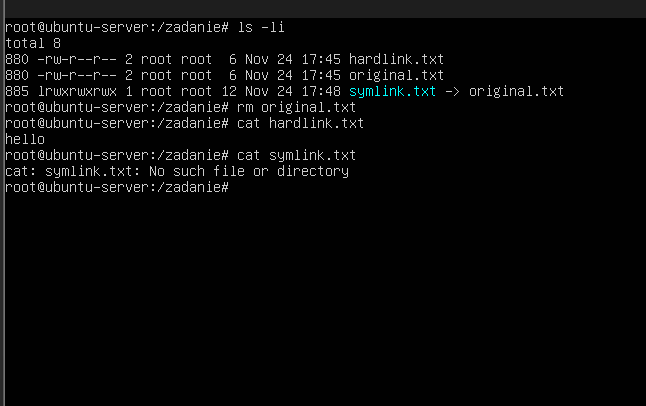
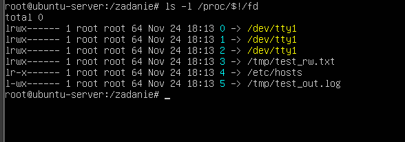
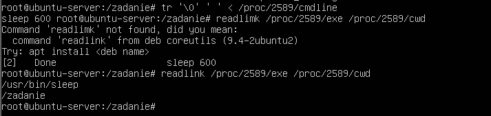

## Схема загрузки
1. Нажатие кнопки питание, запуск BIOS. BIOS тестирует оборудование, находит загрузкчи и запускает его. 
2. Загрузчик (чаще всего GRUB) заглядывает в директорию /boot копирует ядро ОС и запускает его в ОЗУ. Далее передается управление ядру.
3. Ядро монтирует временный каталог как корневой, находит архив с драйверами для чтения дисков.
4. После установки драйвера происходит смена корневой директории на /
5. Далее запускается первый процесс с PID 1, сейчас это чаще всего systemd.

## Вывод команд и отличия lsblk -f,findmnt / и df -hT /
lsblk показывает все блочные устройства, включая не смонтироованные. Информацию меберд из udev B sys
findmnt / показывает только точку монтированияю Информацию беред из ФС ядра
df -hT / показывает только файловую систему смонтированную в / . Инфомрацию берет из систменого вызова. 
 
## Ссылки

## Разбор процесса

## KILL -9
Команда Kill -9 завершает процесс не давая ему времени сохранить данные. 
Сначала следует использовать просто Kill, попробовать мягко завершить процесс и дать ему время на сохранения данных.  
